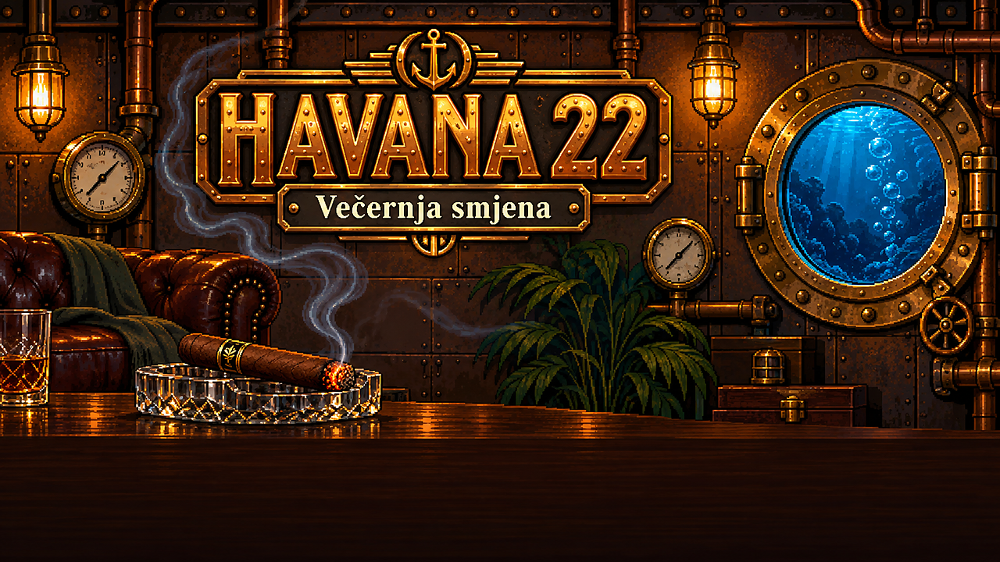

# HAVANA 22 — Večernja smjena

**▶ Igraj u pregledniku: https://zheruel.github.io/havana22-game/**

Igra o cigar loungeu Havana 22 (Frankopanska 22, Zagreb). Ti si Hrvoje, smjena traje od 16:00 do 22:00: poslužuješ cigare i pića, izbacuješ bake koje se žale na dim i gejmere koji se šuljaju na WC, i držiš na oku Roku, Mislava, Matiju i Tomislava.

| Tipka | Što radi |
|---|---|
| WASD / strelice | hodanje |
| E / Razmak | uzmi, posluži, razgovaraj, ventiliraj |
| Q | vikni „Izlazite!“ |
| Esc / M | pauza / zvuk |

Bez instalacije: radi u pregledniku (najbolje Chrome). Lokalno: otvori `game/index.html`.
